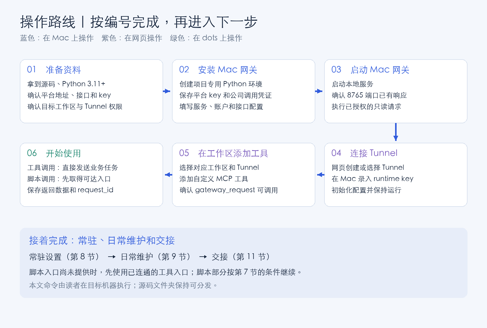
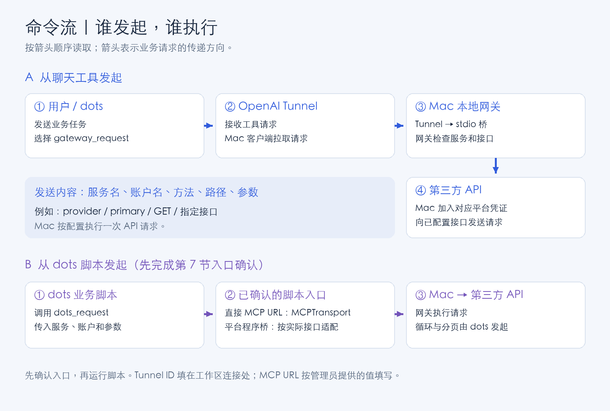
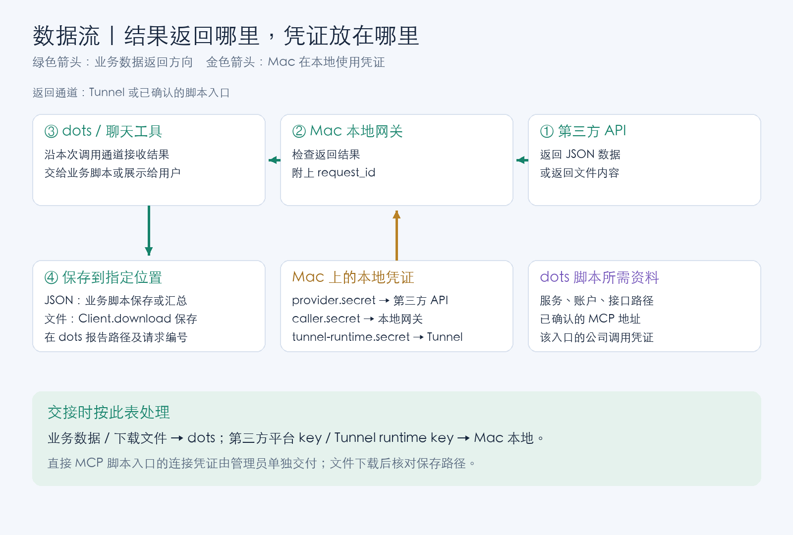

# AI Operations Gateway：中文逐步安装与使用手册

按本手册在目标 Mac 上重新安装，再从对应工作区发起业务请求。

**第一次使用：从第 0 节开始，按顺序做到第 6 节。需要 dots 自己运行 Python 脚本时，再做第 7 节。需要长期运行时，继续做第 8 节。**

本文适用：Apple Silicon Mac、Python 3.11 或更高版本、本仓库当前源码。操作说明核对日期：2026-10-15。

## 目录

- [0. 先准备资料，并认准操作位置](#s0)
- [1. 在 Mac 上放好工程、安装依赖](#s1)
- [2. 在 Mac 上填写配置、录入凭证](#s2)
- [3. 启动网关，完成第一次只读调用](#s3)
- [4. 在网页准备 Tunnel](#s4)
- [5. 在 Mac 上连接 Tunnel](#s5)
- [6. 在工作区添加工具并使用](#s6)
- [7. 可选：让 dots 自己运行 Python 脚本](#s7)
- [8. 设置 Mac 登录后自动启动](#s8)
- [9. 日常启动、停止、修改和更新](#s9)
- [10. 按报错逐项处理](#s10)
- [11. 交接给下一位使用人](#s11)
- [12. 卸载本机安装](#s12)

<a id="s0"></a>
## 0. 先准备资料，并认准操作位置

### 0.1 按路线图操作



### 0.2 给三处操作位置做好标记

| 本文标记 | 到哪里操作 | 在这里做什么 |
| --- | --- | --- |
| **【Mac】** | 准备长期运行网关的那台 Mac 的“终端” | 安装、保存凭证、运行网关与 Tunnel |
| **【网页】** | 浏览器中的 OpenAI Platform 或目标 ChatGPT 工作区 | 创建或选择 Tunnel，添加工具 |
| **【dots】** | dots 云电脑的终端，或让 dots 在自己的云电脑执行 | 安装调用端、运行业务脚本、保存结果 |

1. 在 Mac 按 `Command + 空格`。
2. 输入“终端”，回车打开。
3. 后面写着 **【Mac】** 的命令，粘贴到这个窗口执行。
4. 每次复制一个完整代码框，再按回车。
5. 多行命令连同最后一行一起复制；含 `PY` 的代码框要复制到末尾的 `PY`。
6. 遇到输入提示，按提示填写。输入密钥时屏幕保持空白，粘贴后直接回车。
7. 每一步核对“完成标志”，符合后继续。
8. 新开终端窗口后，先回到工程文件夹。后文会用 `cd "$HOME/AI_Operations_Gateway"`。

本手册统一使用 `~/AI_Operations_Gateway` 作为安装目录。使用已有目录时，把所有 `cd` 命令中的路径改成实际路径，并保留路径两边的英文双引号。

### 0.3 向管理员取得以下资料

| 需要取得的资料 | 填写示意 | 在哪一步使用 |
| --- | --- | --- |
| 工程文件夹或仓库读取权限 | 本仓库源码 | 第 1 节 |
| 平台 API 的域名 | `https://api.example.com`，替换成实际域名 | 第 2 节 |
| 一个已授权的只读接口路径 | `/v1/items`，替换成实际接口 | 第 2 节 |
| 接口允许的查询参数名 | `page,per_page`；没有则留空 | 第 2 节 |
| 接口认证方式 | `bearer` 或 `api_key` | 第 2 节 |
| 平台 API key | 由管理员在 Mac 本地录入 | 第 2 节 |
| API key 的请求头名称 | 选择 `api_key` 时填写，如 `X-API-Key` | 第 2 节 |
| 目标 Platform 组织、ChatGPT 工作区 | 管理员提供名称 | 第 4、6 节 |
| Tunnel ID、Tunnel runtime key | 复用有效配置，或由管理员新建 | 第 4、5 节 |
| 可直接调用的 MCP URL 与入口凭证 | 仅在管理员已提供时填写 | 第 7 节 |

**完成标志：** 至少拿到前七项资料，且管理员确认该只读接口返回 JSON。示意域名和路径需要替换成实际值。

### 0.4 调用时按这张图核对命令去向



### 0.5 交接时按这张图核对数据和凭证位置



<a id="s1"></a>
## 1. 在 Mac 上放好工程、安装依赖

**操作位置：【Mac】**

### 1.1 核对电脑和 Python

执行：

```sh
uname -m
python3 --version
```

**完成标志：** 第一条显示 `arm64`；第二条显示 `Python 3.11.x` 或更高版本。

- 显示 `x86_64`：让管理员提供适合该 Mac 的 Tunnel 安装方式，再继续第 5 节。
- Python 版本较低或提示找不到命令：请管理员先安装 Python 3.11+，重新打开终端，再执行上面两条命令。

### 1.2 将源码放入安装目录

**方式 A：已经拿到工程文件夹。**

1. 在 Finder 打开个人文件夹。可按 `Command + Shift + H`。
2. 把收到的工程文件夹放在这里。
3. 将文件夹命名为 `AI_Operations_Gateway`。
4. 打开文件夹，确认能看到 `README.md`、`requirements.txt`、`macmini_gateway` 和 `dots_request`。

**方式 B：从 GitHub 获取。** 已有仓库读取权限时，执行：

```sh
cd "$HOME"
git clone https://github.com/UbicusMyron/dots-local-gateway.git AI_Operations_Gateway
```

若提示目标文件夹已存在，继续使用已有源码目录。若提示无读取权限，请管理员提供源码文件夹，再按方式 A 操作。

随后执行：

```sh
cd "$HOME/AI_Operations_Gateway"
ls README.md requirements.txt macmini_gateway dots_request
```

**完成标志：** 列出这些文件或目录中的内容，且没有 `No such file or directory`。

### 1.3 安装项目运行环境

```sh
python3 -m venv .venv
.venv/bin/python -m pip install -r requirements.txt
```

等待命令执行结束，再执行：

```sh
.venv/bin/python -c 'import mcp, httpx, uvicorn, certifi; print("运行依赖已就绪")'
```

**完成标志：** 出现 `运行依赖已就绪`。

若安装依赖失败，保留错误信息，按第 10 节处理成功后再继续。

<a id="s2"></a>
## 2. 在 Mac 上填写配置、录入凭证

**操作位置：【Mac】。保持终端位于工程根目录。**

### 2.1 创建本地配置目录

```sh
mkdir -p macmini_gateway/local
chmod 700 macmini_gateway/local
```

### 2.2 生成公司调用凭证

完整复制执行：

```sh
.venv/bin/python - <<'PY'
import os
import secrets
from pathlib import Path
p = Path('macmini_gateway/local/caller.secret')
if p.exists():
    print('公司调用凭证已存在，沿用现有文件。')
else:
    fd = os.open(p, os.O_WRONLY | os.O_CREAT | os.O_EXCL, 0o600)
    with os.fdopen(fd, 'w') as f:
        f.write(secrets.token_urlsafe(32) + '\n')
    print('公司调用凭证已生成。')
PY
```

**完成标志：** 提示已生成或沿用现有文件。

### 2.3 录入平台 API key

执行后，在终端的隐藏输入框粘贴管理员提供的平台 API key，按回车：

```sh
.venv/bin/python -c '
import getpass, os
from pathlib import Path
p = Path("macmini_gateway/local/provider.secret")
if p.exists():
    raise SystemExit("平台凭证已存在；继续第 2.4 步。更换凭证请按第 9.4 节。")
value = getpass.getpass("粘贴平台 API key，按回车：").strip()
if not 8 <= len(value) <= 4096 or any(ord(c) < 33 or ord(c) > 126 for c in value):
    raise SystemExit("格式不符合要求，请向管理员核对后重新执行本步。")
fd = os.open(p, os.O_WRONLY | os.O_CREAT | os.O_EXCL, 0o600)
with os.fdopen(fd, "w") as f:
    f.write(value + "\n")
print("平台凭证已保存。")
'
```

**完成标志：** 出现 `平台凭证已保存`。

凭证仅粘贴到上述终端提示处。聊天、配置示例和交接文档填写文件路径即可。

### 2.4 按提示填写第一个只读接口

执行下面整段命令，然后逐项输入第 0.3 节取得的资料。

```sh
.venv/bin/python -c '
import json, os, re
from pathlib import Path
p = Path("macmini_gateway/local/config.json")
if p.exists():
    raise SystemExit("配置已存在；继续第 2.5 步。修改配置请按第 9.3 节。")
origin = input("API 域名，例如 https://实际域名 ：").strip().rstrip("/")
path = input("只读接口路径，例如 /v1/实际接口 ：").strip()
query = [x.strip() for x in input("允许的查询参数名，英文逗号分隔；没有则回车：").split(",") if x.strip()]
kind = input("认证方式，填写 bearer 或 api_key ：").strip()
if kind not in ("bearer", "api_key"):
    raise SystemExit("认证方式请填写 bearer 或 api_key，重新执行本步。")
auth = {"type": kind, "secret_file": "provider.secret"}
if kind == "api_key":
    auth["header"] = input("请求头名称，例如 X-API-Key ：").strip()
if not re.fullmatch(r"https://[A-Za-z0-9.-]+(?::[0-9]{1,5})?", origin):
    raise SystemExit("域名填写为 https://主机名；接口路径填在下一项。请重新执行。")
config = {"version": 1, "timeout_seconds": 90, "max_response_bytes": 1048576,
          "services": {"provider": {"origin": origin,
          "routes": {path: {"method": "GET", "response": "json", "query": query}},
          "accounts": {"primary": auth}}}}
fd = os.open(p, os.O_WRONLY | os.O_CREAT | os.O_EXCL, 0o600)
with os.fdopen(fd, "w") as f:
    json.dump(config, f, ensure_ascii=False, indent=2)
print("配置已保存。服务名：provider；账户名：primary。")
'
```

填写时按以下规则操作：

| 提示 | 怎么填 |
| --- | --- |
| API 域名 | 填 `https://` 开头的域名；接口路径填到下一项 |
| 只读接口路径 | 填 `/` 开头的完整路径，例如 `/v1/items` |
| 查询参数名 | 只填名字，例如 `page,per_page`；参数的值在第 3.3 步填写 |
| bearer | key 使用 `Authorization: Bearer ...` 时选择 |
| api_key | key 使用 `X-API-Key` 等 `X-` 开头的请求头时选择 |

若平台要求 OAuth 自动刷新、签名算法或其他认证头，请管理员先补齐对应适配，再继续配置。

**完成标志：** 出现 `配置已保存。服务名：provider；账户名：primary。`

### 2.5 检查配置及凭证文件

```sh
.venv/bin/python - <<'PY'
from macmini_gateway import Gateway
from macmini_gateway.core import _secret
from pathlib import Path
Gateway('macmini_gateway/local/config.json')
_secret(Path('macmini_gateway/local/caller.secret'))
print('配置与凭证文件检查通过。')
PY
```

**完成标志：** 出现 `配置与凭证文件检查通过`。

本步只读取本地文件。下一节会执行一次实际只读请求。

<a id="s3"></a>
## 3. 启动网关，完成第一次只读调用

### 3.1 在第一个终端启动服务

**操作位置：【Mac · 终端 A】**

```sh
cd "$HOME/AI_Operations_Gateway"
.venv/bin/python -m macmini_gateway.server \
  --config macmini_gateway/local/config.json \
  --caller-secret macmini_gateway/local/caller.secret \
  --port 8765
```

保持这个窗口打开。服务正常运行时可能没有文字输出，终端会一直停留在运行状态。

### 3.2 在第二个终端查看端口响应

**操作位置：【Mac · 新开终端 B】**

按 `Command + N` 新开一个终端窗口，执行：

```sh
cd "$HOME/AI_Operations_Gateway"
curl -s -o /dev/null -w '%{http_code}\n' http://127.0.0.1:8765/mcp
```

**完成标志：** 显示 `401`。本步使用未携带凭证的请求，看到 `401` 后继续下一步。

若显示 `000` 或连接失败，回到终端 A 查看服务是否已退出，按第 10 节处理。

### 3.3 填写一次实际业务请求的参数

**操作位置：【Mac · 终端 B】**

执行后，按提示填写各参数的值；可选参数留空表示省略该参数。

```sh
.venv/bin/python -c '
import json, os
from pathlib import Path
p = Path("macmini_gateway/local/request.json")
if p.exists():
    raise SystemExit("请求文件已存在；沿用该文件，继续第 3.4 步。")
config = json.loads(Path("macmini_gateway/local/config.json").read_text())
service = config["services"]["provider"]
path = next(iter(service["routes"]))
query = {}
for name in service["routes"][path]["query"]:
    value = input("参数 " + name + " 的值，可选参数留空：")
    if value:
        query[name] = value
request = {"service": "provider", "account": "primary", "method": "GET",
           "path": path, "query": query, "body": None}
fd = os.open(p, os.O_WRONLY | os.O_CREAT | os.O_EXCL, 0o600)
with os.fdopen(fd, "w") as f:
    json.dump(request, f, ensure_ascii=False, indent=2)
print("请求参数已保存。")
'
```

### 3.4 发送已授权的只读请求

```sh
.venv/bin/python - <<'PY'
import json
from pathlib import Path
from dots_request import Client, RequestError
from dots_request.mcp_transport import MCPTransport
try:
    request = json.loads(Path('macmini_gateway/local/request.json').read_text())
    client = Client(
        MCPTransport('http://127.0.0.1:8765/mcp', 'macmini_gateway/local/caller.secret'),
        services={'provider': ['primary']}, timeout=110)
    result = client.get(request['service'], request['account'], request['path'], query=request['query'])
    print(json.dumps(result, ensure_ascii=False, indent=2))
except RequestError as error:
    print('调用失败：', error.code, '请求编号：', error.request_id)
    raise SystemExit(1)
PY
```

**完成标志：** 返回业务数据，包含 `request_id` 和 `ok: true`。记下请求编号，继续第 4 节。

若返回错误，按第 10 节处理；修正后再执行本步。

<a id="s4"></a>
## 4. 在网页准备 Tunnel

**操作位置：【网页】**

1. 打开 [OpenAI 官方 Tunnel 操作页](https://developers.openai.com/api/docs/guides/secure-mcp-tunnels)。
2. 点击页面中的 **Platform tunnel settings** 进入管理页面。
3. 选择管理员指定的 Platform 组织。
4. 找到已有 Tunnel；已有且仍有效时，打开并沿用。
5. 首次配置时，使用页面中的创建入口新建 Tunnel，名称可填 `AI Operations Gateway`。
6. 在关联设置中确认目标 ChatGPT 工作区和所需 Platform 组织。
7. 复制该 Tunnel 的 `tunnel_id`，留待第 5.4 步粘贴。
8. 在管理员提供的凭证入口准备 runtime key，并确认其具备 **Tunnels Read + Use**。
9. 记录该凭证到期时间，交给负责维护的人。

创建或管理 Tunnel 需要 **Tunnels Read + Manage**；添加工具的账号还需具备目标工作区的相应权限。页面缺少操作入口时，让组织或工作区管理员完成本节。

**完成标志：** 已取得 Tunnel ID、有效 runtime key，并确认关联了实际使用的工作区。上述权限和连接入口按 [官方说明](https://developers.openai.com/api/docs/guides/secure-mcp-tunnels) 操作。

<a id="s5"></a>
## 5. 在 Mac 上连接 Tunnel

**操作位置：【Mac · 终端 B】。终端 A 的网关保持运行。**

### 5.1 安装官方 Tunnel 客户端

```sh
cd "$HOME/AI_Operations_Gateway"
.venv/bin/python scripts/install_tunnel_client.py
macmini_gateway/local/bin/tunnel-client help quickstart
```

**完成标志：** 第一条安装命令显示 `Installed verified official tunnel-client`；随后显示客户端使用说明。

若提示客户端已存在，直接执行第二条查看说明。若下载或校验失败，按第 10 节处理。

### 5.2 保存 Tunnel runtime key

```sh
.venv/bin/python -c '
import getpass, os
from pathlib import Path
p = Path("macmini_gateway/local/tunnel-runtime.secret")
if p.exists():
    raise SystemExit("Tunnel 凭证已存在；沿用现有文件，继续第 5.3 步。")
value = getpass.getpass("粘贴 Tunnel runtime key，按回车：").strip()
if not 8 <= len(value) <= 4096 or any(ord(c) < 33 or ord(c) > 126 for c in value):
    raise SystemExit("凭证格式不符合要求，请核对后重新执行。")
fd = os.open(p, os.O_WRONLY | os.O_CREAT | os.O_EXCL, 0o600)
with os.fdopen(fd, "w") as f:
    f.write(value + "\n")
print("Tunnel 凭证已保存。")
'
```

**完成标志：** 出现 `Tunnel 凭证已保存`。

### 5.3 创建本项目的桥接启动文件

```sh
.venv/bin/python - <<'PY'
from pathlib import Path
import shlex
root = Path.cwd().resolve()
p = root / 'macmini_gateway/local/tunnel-bridge.sh'
if p.exists():
    raise SystemExit('桥接文件已存在，继续第 5.4 步。')
command = [str(root / '.venv/bin/python'), '-m', 'macmini_gateway.tunnel_stdio',
           '--caller-secret', str(root / 'macmini_gateway/local/caller.secret'), '--port', '8765']
p.write_text('#!/bin/sh\ncd ' + shlex.quote(str(root)) + ' || exit 1\nexec ' + shlex.join(command) + '\n')
p.chmod(0o700)
print('桥接启动文件已生成。')
PY
```

### 5.4 输入 Tunnel ID 并初始化连接

以下步骤使用名为 `ai-operations-gateway` 的客户端配置。首次执行时填写第 4 节取得的 Tunnel ID。

```sh
.venv/bin/python -c '
import os, shlex, subprocess
from pathlib import Path
root = Path.cwd().resolve()
local = root / "macmini_gateway/local"
tunnel_id = input("粘贴 Tunnel ID，按回车：").strip()
if not tunnel_id.startswith("tunnel_"):
    raise SystemExit("请核对 Tunnel ID 后重新执行。")
env = dict(os.environ)
env["CONTROL_PLANE_API_KEY"] = (local / "tunnel-runtime.secret").read_text().strip()
subprocess.run([str(local / "bin/tunnel-client"), "init",
    "--sample", "sample_mcp_stdio_local", "--profile", "ai-operations-gateway",
    "--tunnel-id", tunnel_id,
    "--mcp-command", shlex.quote(str(local / "tunnel-bridge.sh"))],
    cwd=local, env=env, check=True)
'
```

**完成标志：** 客户端报告配置已生成。把输出中的配置路径记入管理员交接记录。

若提示同名配置已存在，沿用已核对的配置进入下一步；需要改 Tunnel 时，先按客户端 `init --help` 的实际提示处理现有配置。

### 5.5 创建固定的启动入口

```sh
.venv/bin/python - <<'PY'
from pathlib import Path
root = Path.cwd().resolve()
p = root / 'macmini_gateway/local/run_tunnel.py'
if p.exists():
    raise SystemExit('Tunnel 启动入口已存在，继续第 5.6 步。')
p.write_text('''import os
import sys
from pathlib import Path
local = Path(__file__).resolve().parent
binary = str(local / "bin/tunnel-client")
env = dict(os.environ)
env["CONTROL_PLANE_API_KEY"] = (local / "tunnel-runtime.secret").read_text().strip()
action = sys.argv[1] if len(sys.argv) > 1 else "run"
if action not in ("run", "doctor"):
    raise SystemExit("请选择 run 或 doctor")
args = [binary, action, "--profile", "ai-operations-gateway"]
if action == "doctor":
    args.append("--explain")
os.chdir(local)
os.execve(binary, args, env)
''')
p.chmod(0o700)
print('Tunnel 启动入口已生成。')
PY
```

### 5.6 检查配置，再启动 Tunnel

```sh
.venv/bin/python macmini_gateway/local/run_tunnel.py doctor
```

**完成标志：** `doctor` 完成，相关连接检查通过。若有失败项，按输出建议和第 10 节修正，再执行一次。

随后执行：

```sh
.venv/bin/python macmini_gateway/local/run_tunnel.py run
```

保持终端 B 打开。按运行输出中的本地管理地址打开管理页，查看就绪状态和连接状态。不同客户端版本的地址或端口以实际输出为准。

**完成标志：** 客户端保持运行，本地管理页显示已就绪且连接正常。

初始化、`doctor` 与 `run` 的操作顺序参考 [官方 Tunnel 指南](https://developers.openai.com/api/docs/guides/secure-mcp-tunnels)。若当前安装版本提示参数变化，执行 `macmini_gateway/local/bin/tunnel-client help quickstart`，按该版本输出调整。

<a id="s6"></a>
## 6. 在工作区添加工具并使用

**操作位置：【网页】。Mac 的终端 A、B 保持运行。**

### 6.1 添加工具

1. 登录实际使用的 ChatGPT 工作区。
2. 打开 **Plugins**。
3. 点击加号，选择 **Add custom MCP server**。
4. 名称填写 `AI Operations Gateway`。
5. 在 **Connection** 选择 **Tunnel**。
6. 选择第 4 节的 Tunnel，或在允许填写的入口粘贴同一个 Tunnel ID。
7. 按当前页面配置认证。本手册的 stdio 桥在 Mac 本地读取 `caller.secret`；外层沿用工作区和 Tunnel 授权。若页面要求额外认证字段，让管理员确认该工作区的设置。
8. 阅读页面提示，确认后创建。
9. 查看工具列表，找到 `gateway_request`。

页面操作入口按 [官方连接指南](https://developers.openai.com/plugins/deploy/connect-chatgpt) 和 [Tunnel 指南](https://developers.openai.com/api/docs/guides/secure-mcp-tunnels) 核对。工作区看不到入口时，请管理员检查该账号的自定义 MCP 工具权限。

**完成标志：** 工具列表中出现 `gateway_request`。

### 6.2 取出本次业务请求参数

**操作位置：【Mac · 新开终端 C】**

```sh
cd "$HOME/AI_Operations_Gateway"
.venv/bin/python - <<'PY'
import json
from pathlib import Path
request = json.loads(Path('macmini_gateway/local/request.json').read_text())
print(json.dumps({'request': request}, ensure_ascii=False, indent=2))
PY
```

复制输出的 JSON。确认其中的业务参数适合发到目标工作区。

### 6.3 在工作区执行第一次工具调用

**操作位置：【网页 / dots 对话】**

选择刚添加的工具，将下列文字连同上一步的 JSON 发给 dots：

> 请使用 AI Operations Gateway 的 gateway_request，按我提供的 JSON 执行这次已授权的只读请求。完成后列出 request_id、ok、返回的数据摘要。若调用失败，请给出错误代码和请求编号。

**完成标志：** 实际工具调用返回 `ok: true`、请求编号和业务结果。

仅显示工具名称时，继续完成上述实际调用。

### 6.4 以后从手机或桌面发起任务

1. 登录同一账号的目标工作区。
2. 打开可使用该工具的对话。
3. 说明要访问的服务、账户、接口及查询条件。
4. 要求返回请求编号与业务结果。
5. 涉及分页、循环或文件时，明确需要的页数、终止条件或保存位置。

可复制下面这段再填写具体任务：

> 请使用 AI Operations Gateway，服务 provider、账户 primary，调用我们已经配置的接口。我的任务是：〔填写任务〕。查询条件是：〔填写条件〕。完成后返回业务结果与 request_id；文件请保存到我指定的位置并报告路径。

<a id="s7"></a>
## 7. 可选：让 dots 自己运行 Python 脚本

### 7.1 先让管理员确认脚本入口

**操作位置：【dots 对话】**

发送：

> 请确认你所在的云电脑是否具备可供 Python 程序调用的网关入口。若有直接可达的 Streamable HTTP MCP URL，请列出地址与凭证文件路径；若使用平台提供的程序工具桥，请列出实际调用接口和现有适配方式。随后按本仓库 README 第 7 节选择对应步骤。请分别说明工具入口与 Python 脚本入口的可用状态。

按返回结果选择：

| 得到的结果 | 接下来做什么 |
| --- | --- |
| 管理员提供了可达的 `https://.../mcp` 地址和入口凭证 | 继续第 7.2～7.5 步 |
| 平台提供程序工具桥，已有适用的 `Transport` 适配器 | 按该适配器说明创建 `Client`，保留下面的业务调用方式 |
| 只有 Tunnel ID 或工具名称 | 继续使用第 6 节；请管理员补齐脚本入口后再做本节 |

填写 URL 时采用管理员提供的直接入口。`127.0.0.1` 仅用于脚本与网关位于同一台机器的情况。新的远程入口由管理员在明确范围后配置。

### 7.2 安装 dots 调用端

**操作位置：【dots 云电脑终端】**

将源码放到 dots 的工程目录，进入能看到 `README.md` 的那一层。已有仓库读取权限时，可执行：

```sh
cd "$HOME"
git clone https://github.com/UbicusMyron/dots-local-gateway.git AI_Operations_Gateway
cd "$HOME/AI_Operations_Gateway"
python3 --version
python3 scripts/install_dots.py
```

已有源码时，从 `cd` 进入已有目录后执行安装命令即可。Python 需为 3.11+。

**完成标志：** 出现 `Installation complete`。

### 7.3 保存 dots 的连接配置

仍在 dots 工程根目录执行：

```sh
mkdir -p .dots-local
chmod 700 .dots-local
.venv/bin/python -c '
import getpass, json, os
from pathlib import Path
from dots_request.mcp_transport import MCPTransport
local = Path(".dots-local")
p = local / "connection.json"
secret = local / "caller.secret"
if p.exists() or secret.exists():
    raise SystemExit("连接文件已存在，请管理员检查已有配置后使用。")
url = input("粘贴管理员提供的 MCP URL：").strip()
value = getpass.getpass("粘贴该入口的公司调用凭证：").strip()
fd = os.open(secret, os.O_WRONLY | os.O_CREAT | os.O_EXCL, 0o600)
with os.fdopen(fd, "w") as f:
    f.write(value + "\n")
try:
    MCPTransport(url, secret)
    fd = os.open(p, os.O_WRONLY | os.O_CREAT | os.O_EXCL, 0o600)
    with os.fdopen(fd, "w") as f:
        json.dump({"url": url}, f, indent=2)
except Exception:
    secret.unlink()
    raise
print("dots 连接配置已保存。")
'
```

此处输入管理员交付的入口凭证。第三方平台 key 和 Tunnel runtime key 按第 2、5 节保存在 Mac。

**完成标志：** 出现 `dots 连接配置已保存`。

### 7.4 放入业务请求参数

1. 取得第 6.2 节展示的 JSON 中 `request` 对应的内部对象。
2. 在 dots 工程根目录执行：

```sh
nano .dots-local/request.json
```

3. 粘贴内部对象。例如下面结构中的路径和参数，应替换成第 3 节实际成功的值：

```json
{
  "service": "provider",
  "account": "primary",
  "method": "GET",
  "path": "/填写实际路径",
  "query": {},
  "body": null
}
```

4. 按 `Control + O` 保存，再按回车确认文件名。
5. 按 `Control + X` 退出。

### 7.5 执行并保存 JSON 结果

```sh
.venv/bin/python - <<'PY'
import json
from datetime import datetime
from pathlib import Path
from dots_request import Client, RequestError
from dots_request.mcp_transport import MCPTransport
local = Path('.dots-local')
try:
    connection = json.loads((local / 'connection.json').read_text())
    request = json.loads((local / 'request.json').read_text())
    client = Client(MCPTransport(connection['url'], local / 'caller.secret'),
        services={request['service']: [request['account']]}, timeout=110)
    result = client.get(request['service'], request['account'], request['path'], query=request['query'])
    target = local / ('result-' + datetime.now().strftime('%Y%m%d-%H%M%S-%f') + '.json')
    with target.open('x') as f:
        json.dump(result, f, ensure_ascii=False, indent=2)
    print('调用成功，请求编号：', result['request_id'])
    print('结果文件：', target.resolve())
except RequestError as error:
    print('调用失败：', error.code, '请求编号：', error.request_id)
    raise SystemExit(1)
PY
```

**完成标志：** 显示请求编号和结果文件的绝对路径。让 dots 打开该文件，按你的业务需要汇总。

### 7.6 可选：下载文件

1. 请管理员在 Mac 的配置中加入实际文件接口，设置 `"response": "file"`，填写允许的查询参数。
2. 按第 9.3 节检查配置并重启网关。
3. 在 dots 把 `.dots-local/request.json` 的 `path` 与 `query` 改为该文件接口的值。
4. 执行：

```sh
.venv/bin/python - <<'PY'
import json
from datetime import datetime
from pathlib import Path
from dots_request import Client
from dots_request.mcp_transport import MCPTransport
local = Path('.dots-local')
connection = json.loads((local / 'connection.json').read_text())
request = json.loads((local / 'request.json').read_text())
client = Client(MCPTransport(connection['url'], local / 'caller.secret'),
    services={request['service']: [request['account']]}, timeout=110)
out = local / 'downloads'
out.mkdir(exist_ok=True)
target = out / ('download-' + datetime.now().strftime('%Y%m%d-%H%M%S-%f') + '.bin')
saved = client.download(request['service'], request['account'], request['path'], target, query=request['query'])
print('文件已保存：', saved.resolve())
print('文件大小：', saved.stat().st_size, '字节')
PY
```

5. 根据实际文件格式，将 `.bin` 改成合适的扩展名。
6. 让 dots 报告文件路径，并按任务要求读取文件。

本手册网关配置使用 1 MiB 上游响应上限。需要较大文件时，由管理员同时核对网关上限和 MCP 适配器限制后调整；当前适配器每次 HTTP 响应上限为 4 MiB。

### 7.7 可选：发送已授权的 JSON POST

1. 请管理员确认具体接口、允许字段、认证及调用范围。
2. 在 Mac 的 `config.json` 中配置该路径的 `method` 为 `POST`、`response` 为 `json`，填写 `body_fields` 和 `max_body_bytes`。
3. 按第 9.3 节检查并重启网关。
4. dots 业务脚本沿用第 7.5 节的连接和 `Client` 创建方式。
5. 将请求一行替换为下面形式，填写实际路径及已允许的字段：

```python
result = client.post('provider', 'primary', '/填写已配置的POST路径',
                     body={'填写允许的字段名': '填写业务值'})
```

6. 保存返回数据和 `request_id`。需传入 `stream` 时，填写 `False`。

<a id="s8"></a>
## 8. 设置 Mac 登录后自动启动

**操作位置：【Mac】。先完成第 6.3 节的实际工具调用。**

以下步骤使用当前 Mac 用户的 LaunchAgent。完成后，用该用户登录 Mac 时自动启动；重启电脑后先登录该用户。需要登录前运行的机器，由管理员另行配置系统级服务。

### 8.1 停止两个前台窗口

1. 到终端 B，按 `Control + C` 停止 Tunnel。
2. 到终端 A，按 `Control + C` 停止网关。
3. 两个窗口都出现可以输入命令的提示符后，继续。

### 8.2 生成两份自动启动配置

```sh
cd "$HOME/AI_Operations_Gateway"
.venv/bin/python - <<'PY'
from pathlib import Path
import plistlib
root = Path.cwd().resolve()
local = root / 'macmini_gateway/local'
agent_dir = Path.home() / 'Library/LaunchAgents'
agent_dir.mkdir(parents=True, exist_ok=True)
python = str(root / '.venv/bin/python')
jobs = {
    'com.cuhk.ai-operations-gateway': [python, '-m', 'macmini_gateway.server',
        '--config', str(local / 'config.json'), '--caller-secret', str(local / 'caller.secret'), '--port', '8765'],
    'com.cuhk.ai-operations-tunnel': [python, str(local / 'run_tunnel.py'), 'run'],
}
for label in jobs:
    if (agent_dir / (label + '.plist')).exists():
        raise SystemExit('启动文件已存在：' + label + '。按第 9 节管理已有服务。')
for label, argv in jobs.items():
    log = local / (label + '.log')
    data = {'Label': label, 'ProgramArguments': argv, 'WorkingDirectory': str(root),
            'RunAtLoad': True, 'KeepAlive': True, 'ThrottleInterval': 5, 'Umask': 63,
            'StandardOutPath': str(log), 'StandardErrorPath': str(log)}
    target = agent_dir / (label + '.plist')
    with target.open('xb') as f:
        plistlib.dump(data, f)
    target.chmod(0o600)
    print('已生成：', target)
PY
```

**完成标志：** 显示两份 `.plist` 文件路径。

### 8.3 启动网关，再启动 Tunnel

```sh
launchctl bootstrap "gui/$(id -u)" "$HOME/Library/LaunchAgents/com.cuhk.ai-operations-gateway.plist"
launchctl bootstrap "gui/$(id -u)" "$HOME/Library/LaunchAgents/com.cuhk.ai-operations-tunnel.plist"
```

### 8.4 查看运行状态

```sh
launchctl print "gui/$(id -u)/com.cuhk.ai-operations-gateway"
launchctl print "gui/$(id -u)/com.cuhk.ai-operations-tunnel"
```

**完成标志：** 两项均显示 `state = running`。等几秒后再查看一次，确认进程持续运行。

随后回到工作区，重复第 6.3 节的只读请求，确认收到新的请求编号。

### 8.5 保持 Mac 可用

1. 将 Mac 接入稳定电源和网络。
2. 在 macOS 系统设置中搜索“睡眠”，按本机管理要求设置服务期间保持唤醒。
3. 保持运行该服务的用户处于登录状态。
4. 重启后登录该用户，重复第 8.4 节和一次工具调用。
5. 将 runtime key 到期时间加入管理员维护记录。

<a id="s9"></a>
## 9. 日常启动、停止、修改和更新

**操作位置：【Mac】。以下常驻命令适用于已经完成第 8 节的机器。**

### 9.1 查看日志

```sh
cd "$HOME/AI_Operations_Gateway"
tail -n 60 macmini_gateway/local/com.cuhk.ai-operations-gateway.log
tail -n 60 macmini_gateway/local/com.cuhk.ai-operations-tunnel.log
```

查问题时，记录报错时间、错误代码及 `request_id`。向同事提交经过检查的相关行。

### 9.2 停止、重新启动或恢复服务

停止时，先停止 Tunnel，再停止网关：

```sh
launchctl bootout "gui/$(id -u)/com.cuhk.ai-operations-tunnel"
launchctl bootout "gui/$(id -u)/com.cuhk.ai-operations-gateway"
```

完成后，可用第 8.4 节的 `print` 命令确认服务已卸载。遇到短暂的退出状态，等几秒再查看。

恢复已停止的服务：执行第 8.3 节的两条 `bootstrap` 命令。

重启仍已加载的服务：

```sh
launchctl kickstart -k "gui/$(id -u)/com.cuhk.ai-operations-gateway"
launchctl kickstart -k "gui/$(id -u)/com.cuhk.ai-operations-tunnel"
```

最后重复第 8.4 节及一次实际工具调用。

### 9.3 修改平台地址、接口或允许字段

1. 在 Mac 进入工程目录。
2. 复制一份本地备份：

```sh
cp -p macmini_gateway/local/config.json "macmini_gateway/local/config.backup.$(date +%Y%m%d-%H%M%S).json"
nano macmini_gateway/local/config.json
```

3. 修改管理员确认的字段。保留 JSON 中的双引号和逗号格式。
4. 按 `Control + O`、回车保存；按 `Control + X` 退出。
5. 执行第 2.5 节的配置检查。
6. 检查通过后，执行第 9.2 节的重启命令。
7. 更新业务端对应的路径和参数，完成一次实际调用。

增加下载路由时，在 `routes` 内加入实际路径，填写：

```json
"/填写实际文件路径": {"method": "GET", "response": "file", "query": []}
```

增加 POST 路由时，在 `routes` 内加入实际路径和字段，例如：

```json
"/填写实际POST路径": {
  "method": "POST",
  "response": "json",
  "query": [],
  "body_fields": ["填写允许的字段名"],
  "max_body_bytes": 16384
}
```

将片段中的路径和字段替换成实际值；与已有路由之间用英文逗号分隔。

### 9.4 更换平台 key 或 Tunnel runtime key

1. 按第 9.2 节停止两项服务。使用前台方式时，在终端 B、A 依次按 `Control + C`。
2. 执行下面命令，按提示选择文件和录入新值：

```sh
.venv/bin/python -c '
import getpass, os
from pathlib import Path
choice = input("更换平台 key 填 1，更换 Tunnel runtime key 填 2：").strip()
names = {"1": "provider.secret", "2": "tunnel-runtime.secret"}
if choice not in names:
    raise SystemExit("请选择 1 或 2。")
p = Path("macmini_gateway/local") / names[choice]
value = getpass.getpass("粘贴新凭证，按回车：").strip()
if not 8 <= len(value) <= 4096 or any(ord(c) < 33 or ord(c) > 126 for c in value):
    raise SystemExit("格式不符合要求，请重新核对。")
tmp = p.with_name(p.name + ".new")
fd = os.open(tmp, os.O_WRONLY | os.O_CREAT | os.O_EXCL, 0o600)
with os.fdopen(fd, "w") as f:
    f.write(value + "\n")
os.replace(tmp, p)
print("凭证已更新。")
'
```

3. 执行第 2.5 节配置检查。
4. 按第 8.3 节恢复两项常驻服务；前台方式则按第 3.1、5.6 节启动。
5. 完成一次工具调用。
6. 管理员在相应平台处理旧凭证并更新到期记录。

公司调用凭证更换时，由管理员同步更新所有直接 MCP 调用端的 `caller.secret`，再恢复服务和业务调用。

### 9.5 更新工程源码

1. 记录当前可用版本和本地配置备份位置。
2. 按第 9.2 节停止服务。
3. 使用 Git 获取源码的机器，执行：

```sh
cd "$HOME/AI_Operations_Gateway"
git status --short
git pull --ff-only
.venv/bin/python -m pip install -r requirements.txt
```

4. `git status` 出现本地修改或 `git pull` 报错时，让维护人员处理后继续。
5. 使用文件夹交付的机器，由维护人员替换运行源码，保留 `macmini_gateway/local/` 中的现有配置。
6. 执行第 2.5 节检查，恢复服务，再完成一次实际调用。
7. 工程路径发生变化时，由管理员同步重新生成桥接脚本和两份启动配置，再启动。

<a id="s10"></a>
## 10. 按报错逐项处理

| 看到的现象 | 按顺序执行 |
| --- | --- |
| `python3: command not found` 或版本低于 3.11 | 请管理员安装 Python 3.11+ → 重新打开终端 → 重做第 1.1 节 |
| `No such file or directory` | 执行 `pwd` → 回到工程根目录 → 核对 `README.md` 与 `requirements.txt` 是否在当前目录 |
| `No module named mcp`、`httpx` 等 | 使用 `.venv/bin/python` → 重新执行第 1.3 节安装命令 |
| `No matching distribution found`、网络或证书下载错误 | 保存完整错误 → 请管理员核对 Python 版本、依赖源、网络与公司证书 → 安装成功后继续 |
| Tunnel 安装校验失败 | 请管理员检查官方下载和校验信息 → 使用核验后的官方版本 → 重新执行第 5.1 节 |
| `Gateway configuration failed` | 执行第 2.5 节 → 核对域名、路径、认证类型、凭证文件及权限 |
| 凭证权限不正确 | 执行下方权限修正命令 → 重做第 2.5 节 |
| `Address already in use` | 执行下方端口检查 → 已有本项目网关时使用已有进程 → 前台进程按 `Control + C` 停止 → 再启动需要的实例 |
| 第 3.2 节显示 `401` | 继续第 3.3、3.4 节，使用已保存的公司调用凭证执行实际请求 |
| 实际调用显示 `UNAUTHENTICATED` / HTTP 401 | 核对入口地址及该入口的公司调用凭证 → 管理员同步凭证文件 → 重试 |
| `UNKNOWN_CONNECTION` | 核对请求中的服务名与账户名；本文首次配置固定为 `provider` 和 `primary` |
| `INVALID_REQUEST` | 对照 `config.json` 核对路径、GET/POST、允许参数名、JSON 字段与 `stream` 值 |
| `UPSTREAM_ERROR` | 用 request_id 查看 Mac 日志 → 核对平台 key、权限、平台地址、API 状态及响应大小 |
| `TIMEOUT` / `TRANSPORT_ERROR` | 查看两项服务及 Tunnel 状态 → 按 request_id 核对执行情况 → 由业务决定是否再次调用 |
| `INVALID_CONFIG` | 检查客户端 JSON、URL、凭证文件权限及配置字段 → 按对应步骤修正 |
| `DESTINATION_EXISTS` | 更换下载文件名或明确处理已有文件 → 重新下载 |
| 工作区找不到 Tunnel | 核对组织和工作区关联 → 核对账号 Read + Use 权限 → 重新进入添加工具页面 |
| 工作区工具可用，但 dots Python 失败 | 回到第 7.1 节确认程序入口 → 使用管理员提供的 URL 或现有程序桥适配器 |
| Tunnel `doctor` 失败或未就绪 | 核对 runtime key 有效期、权限、Tunnel ID → 核对网关正在运行 → 检查 Mac 网络 → 再执行 `doctor` |
| `Bootstrap failed: 5` | 用第 8.4 节查询是否已加载 → 已加载时用 `kickstart` → 未加载时用下方 `plutil` 检查配置并查看日志 |
| `Could not find service` / `No such process` | 当前服务已停止或尚未加载 → 需要运行时执行第 8.3 节 |
| 自动启动后立刻退出 | 查看对应日志 → 核对 `.venv/bin/python`、工程目录和凭证文件仍存在 → 修正后重新启动 |
| 重启 Mac 后工具不可用 | 登录安装服务的 Mac 用户 → 查看两项服务状态 → 查看 Tunnel 就绪状态 → 完成一次实际调用 |

权限修正，在 Mac 工程根目录执行：

```sh
chmod 700 macmini_gateway/local
chmod 600 macmini_gateway/local/caller.secret macmini_gateway/local/provider.secret
```

已创建 Tunnel 凭证时，再执行：

```sh
chmod 600 macmini_gateway/local/tunnel-runtime.secret
```

端口检查：

```sh
lsof -nP -iTCP:8765 -sTCP:LISTEN
```

自动启动配置检查：

```sh
plutil -lint "$HOME/Library/LaunchAgents/com.cuhk.ai-operations-gateway.plist"
plutil -lint "$HOME/Library/LaunchAgents/com.cuhk.ai-operations-tunnel.plist"
```

**完成标志：** 修正后重新执行原步骤，得到该步骤指定的成功结果。

<a id="s11"></a>
## 11. 交接给下一位使用人

按下面清单逐项完成：

- [ ] 告知运行网关的 Mac、登录用户、工程绝对路径。
- [ ] 告知目标工作区、工具名称、Tunnel ID。
- [ ] 提供允许使用的服务名、账户名、路径、参数和读写范围。
- [ ] 提供一次实际成功调用的时间及 `request_id`。
- [ ] 确认两项常驻服务处于 `running`，并完成一次工作区工具调用。
- [ ] 需要脚本调用时，单独交付已验证的程序入口与适用凭证。
- [ ] 确认业务结果文件保存位置和取回方式。
- [ ] 记录 runtime key 到期日、负责人及更新安排。
- [ ] 记录 Tunnel 客户端初始化时显示的配置路径。
- [ ] 提供本 README，说明第 9 节维护、第 10 节排错、第 12 节卸载。

交付源码前，在工程根目录执行：

```sh
git status --short
```

由维护人员核对拟提交清单包含源码、文档和配图。本地凭证、日志、`.venv/`、`macmini_gateway/local/` 与 `.dots-local/` 按 `.gitignore` 保留在各自机器上。

<a id="s12"></a>
## 12. 卸载本机安装

**操作位置：【Mac】。确认本机已结束使用，并按管理员安排处理需要保留的配置。**

### 12.1 停止服务

完成过第 8 节的机器，执行：

```sh
launchctl bootout "gui/$(id -u)/com.cuhk.ai-operations-tunnel"
launchctl bootout "gui/$(id -u)/com.cuhk.ai-operations-gateway"
```

使用前台方式时，在两个运行窗口依次按 `Control + C`。

用第 8.4 节的 `print` 命令确认两项服务已停止。

### 12.2 删除本项目的启动项和运行材料

下列命令会删除本机凭证副本、日志、官方 Tunnel 二进制及专用 Python 环境。需要保留的配置先由管理员转存至批准的位置，再执行：

```sh
cd "$HOME/AI_Operations_Gateway"
python3 - <<'PY'
from pathlib import Path
import os
import shutil
import subprocess
root = Path.cwd().resolve()
if not (root / 'macmini_gateway/server.py').exists() or not (root / 'dots_request/client.py').exists():
    raise SystemExit('请进入本项目根目录后执行。')
for label in ('com.cuhk.ai-operations-tunnel', 'com.cuhk.ai-operations-gateway'):
    result = subprocess.run(['launchctl', 'print', f'gui/{os.getuid()}/{label}'], capture_output=True)
    if result.returncode != 113:
        raise SystemExit('请先核实服务已停止：' + label)
for label in ('com.cuhk.ai-operations-tunnel', 'com.cuhk.ai-operations-gateway'):
    p = Path.home() / 'Library/LaunchAgents' / (label + '.plist')
    if p.exists():
        p.unlink()
for name in ('macmini_gateway/local', '.venv', '.dots-local'):
    p = root / name
    if p.is_symlink():
        raise SystemExit('请管理员检查符号链接：' + str(p))
    if p.exists():
        shutil.rmtree(p)
print('本机项目运行材料已删除，源码与文档已保留。')
PY
```

### 12.3 收尾

1. 管理员按第 5.4 节记录的路径，处理本项目专用的 Tunnel profile；共享配置按实际归属保留。
2. 在平台管理页撤销本机专用且已停用的 runtime key。
3. 按使用范围处理工作区中的工具连接和对应 Tunnel。
4. dots 上如需卸载，由管理员停止相关业务后删除该工程的 `.venv/` 与 `.dots-local/`。
5. 重新检查本机服务状态，确认本项目网关与 Tunnel 已退出。

**完成标志：** 本机常驻服务及启动项已移除，本项目运行环境与本地凭证副本已清理；源码和本手册保留，可在下一台机器重新安装。
