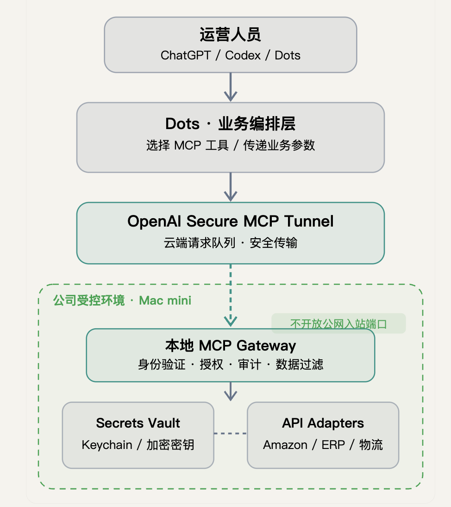

# AI Operations Gateway 使用教程

**第一次安装的人，从头开始做。已经有人帮你装好的人，直接看[第七步：开始使用](#use)。**

这份教程会让你在两个地方说话：**Mac 上的 Codex**，以及**平时使用的 dots 对话**。需要输入密钥或登录账号时，由你本人操作；安装、改配置和运行检查交给 Codex。

先打开下面这张图，认一下“运营人员”和“公司受控环境 · Mac mini”这两个位置，再继续往下做。

配图沿用提供的原图。安装时请 Codex 按本仓库实际功能执行：当前密钥保存在 Mac 本地受限文件中；图中列出的第三方平台，按需要逐个接入。

## 先选你现在要做的事

| 你现在的情况 | 从哪里开始 |
| --- | --- |
| 第一次安装，想把整套东西用起来 | 从下面的准备工作开始 |
| 同事已经安装好了，让你使用 | [第七步：开始使用](#use) |
| 原来能用，现在出问题了 | [第九步：出问题时](#help) |
| 你是负责安装的 Codex 或维护人员 | 阅读本教程，再按[技术附录](docs/INSTALL-REFERENCE.md)执行 |

---

## 准备工作：找齐三样东西

### 1. 一台用来运行服务的 Mac

就是图中“公司受控环境”里的那台电脑。

- 把它接上电源和网络。
- 登录你准备用来运行服务的 Mac 账号。
- 后面的安装操作都在这台 Mac 上做。

### 2. 能在这台 Mac 上使用的 Codex

1. 打开 Mac 上的 **Codex 应用**。
2. 按应用提示登录。
3. 确认能打开一个对话并发送消息。

如果 Mac 上还没有 Codex，把下面这句话发给负责电脑的同事：

> 请帮我在准备运行网关的 Mac 上安装并登录 Codex，让它能够读取项目文件夹、执行本地安装命令。完成后请告诉我从哪里打开项目对话。

**做到这里就算完成：你能在这台 Mac 的 Codex 里发消息。**

### 3. 一个想完成的具体任务

先选一个简单的“查看资料”任务。比如：

> 查看公司 GitHub 组织里，我的账号有权查看的仓库名称。

也可以是你实际使用的平台。把“平台名称”和“想查看什么”写清楚即可。

如果平台账号由同事管理，把下面这段发给他：

> 我准备把【平台名称】接入公司的 AI Operations Gateway，第一次只做【想查看的内容】。请确认是否可以读取这些资料，并准备相应的平台 API 凭证。凭证请由管理员在运行网关的 Mac 上录入。后面若需要登录 OpenAI 的管理页面或开启工作区权限，也请协助完成。

把两个 `【……】` 换成自己的内容，再发送。平台凭证也可能叫 **API key、Token、访问令牌**；后面按 Codex 提示录入。

**做到这里就算完成：你知道要接入哪个平台、第一次查什么，以及谁能提供账号权限。**

---

## 第一步：把项目文件夹放到 Mac 上

**你现在操作：Mac 的浏览器和文件夹。**

### 已经有项目文件夹

1. 打开 Finder，也就是 Mac 上用来查看文件的应用。
2. 打开收到的项目文件夹。
3. 找到 `README.md`、`macmini_gateway`、`dots_request`。
4. 三个都能看到，就直接进入第二步。

### 还没有项目文件夹

1. 在 Mac 的浏览器打开[项目页面](https://github.com/UbicusMyron/dots-local-gateway)。
2. 登录有权查看这个仓库的 GitHub 账号。
3. 找到 **Code** 按钮，点击。
4. 在展开的菜单里点击 **Download ZIP**。
5. 下载完成后，打开 Mac 的“下载”文件夹。
6. 双击下载的 ZIP 文件，得到解压后的文件夹。
7. 打开解压后的文件夹，找到 `README.md`、`macmini_gateway`、`dots_request`。

网页显示没有权限或找不到仓库时，把项目页面链接发给负责人，请他提供整个项目文件夹。拿到文件夹后，按上面的“已经有项目文件夹”操作。

**做到这里就算完成：你已经在 Finder 中找到包含这三个名字的文件夹。**

---

## 第二步：让 Mac 上的 Codex 接手安装

**你现在操作：这台 Mac 上的 Codex。**

1. 打开 Codex。
2. 在项目或文件夹选择入口，选择第一步找到的项目文件夹。
3. 在这个项目里打开一个对话。
4. 把下面整段话复制进去，发送。

> 请先确认你能读取这个项目的 README.md、AGENTS.md 和 docs/INSTALL-REFERENCE.md，并告诉我你读到的项目文件夹路径。
>
> 我完全不懂技术，请带我在当前这台 Mac 上安装 AI Operations Gateway。先读取项目规则和技术附录，检查已有环境和安装记录。可以复用的配置请沿用。
>
> 现在先做安装准备：确认电脑和 Python 是否符合要求、安装本项目运行依赖、准备本地配置目录。实际业务平台和范围等我下一条消息确认后再配置。
>
> 请你执行技术操作。需要我配合时，一次只让我做一件事，明确告诉我打开哪个窗口、点哪里、填什么，以及完成后回复什么。完成这一步后，用普通话告诉我“安装准备已完成”，或说明还缺哪一项。

### 发出去之后，你做什么

- Codex 正在执行时，等待它完成。
- 出现权限提示时，查看是否是读取本项目、安装本项目依赖等本次操作；确认符合后按界面允许。
- Codex 找不到文件夹时，把第一步的文件夹重新选入项目，再发送下面这句话。

> 请先帮我确认项目文件夹是否选对。告诉我当前能看到哪些文件，以及我应该重新选择哪一层文件夹。

**做到这里就算完成：Codex 明确告诉你“安装准备已完成”。只有“我可以帮你安装”时，让它继续实际执行。**

---

## 第三步：告诉 Codex 要接哪个平台

**继续使用：刚才那一个 Mac 上的 Codex 对话。**

把下面这段复制过去，先修改 `【……】`：

> 我要接入的平台是：【平台名称】。
> 我第一次要完成的任务是：【想查看的具体资料】。
> 本次允许读取的范围是：【例如某个组织、店铺或账号下的资料】。
> 该账号的管理员是：【自己或负责同事】。
>
> 我确认在当前这台 Mac 上配置这个平台，并在凭证就绪后执行一次上述范围内的只读查询。请查阅该平台的官方资料，确定地址、认证方式、所需权限和调用参数，完成本地配置。
>
> 请把需要我提供的资料逐项问清楚。密钥由我或管理员在 Mac 本地隐藏输入窗口录入。请告诉我打开哪个窗口、在哪里粘贴，完成后只报告是否保存成功。

例如，你可以把前四行改成：

> 我要接入的平台是：GitHub。
> 我第一次要完成的任务是：查看公司组织内的仓库名称。
> 本次允许读取的范围是：管理员指定的公司组织中，当前凭证有权查看的仓库资料。
> 该账号的管理员是：负责公司 GitHub 的同事。

### Codex 问到你不懂的内容时

直接回复：

> 这个词我不懂。请告诉我应该去哪个网站、哪个页面找它。如果需要管理员处理，请给我一段可以原样转发给管理员的话。

### 轮到你输入密钥时

1. 让 Codex 先准备好本地录入方式，并指出需要打开的窗口。
2. 到那个窗口里，确认已经出现输入提示。
3. 粘贴管理员提供的密钥。
4. 按回车。隐藏输入时，屏幕可能保持空白，按提示操作即可。
5. 回到 Codex 对话，回复：`已经录入，请继续。`

密钥填写在 Codex 指定的本地隐藏输入处。对话中只回复录入状态。

### 让 Codex 完成一次实际查询

录入后发送：

> 请继续执行刚才授权的只读查询。成功后，用我能看懂的话展示查询结果，并附上这次请求的编号。如果失败，请你定位问题，并只告诉我下一件需要配合的事。

**做到这里就算完成：你看到了实际查询结果和请求编号。只看到“文件已保存”或“配置已生成”时，继续让 Codex 完成查询。**

---

## 第四步：让你的工作区能够连接这台 Mac

**先用 Mac 上的 Codex；需要登录时，再切到浏览器。**

先确认你平时使用的 ChatGPT 工作区名称。可以在自己的账号或工作区切换位置查看。拿不准时，请同事告诉你应选哪一个。

然后把下面这段发给 Mac 上的 Codex：

> 本机查询已经成功。现在请将这台 Mac 的网关接入我实际使用的工作区：【填写工作区名称】。
>
> 我授权你为这个项目配置官方 Secure MCP Tunnel。请先核对当前官方说明、已有 Tunnel、对应组织和工作区关联，优先复用适用配置，然后安装或配置本项目的 Tunnel 客户端。
>
> 请你完成能够自动执行的操作。网页操作需要登录或权限时，请让我本人完成；需要浏览器访问能力时，告诉我如何在当前应用中提供。请一次只给我一个页面操作，明确写出按钮名称和要填写的内容。
>
> Tunnel 的运行密钥也由我或管理员在 Mac 本地隐藏输入处录入。最后请确认客户端正在运行，连接已经就绪。

### 网页操作时照这张表做

| Codex 让你做的事 | 你怎么配合 |
| --- | --- |
| 登录 OpenAI 管理页面 | 打开它给出的官方链接，自己完成账号登录和验证码 |
| 选择组织 | 选择管理员确认的组织；拿不准时让管理员确认名称 |
| 选择或创建 Tunnel | 按 Codex 当步说明操作，完成后回到对话告诉它 |
| 提供 Tunnel ID | 复制页面上标为 Tunnel ID 的那串编号，按 Codex 指示填写 |
| 录入 runtime key | 在 Mac 本地隐藏输入处粘贴，回车后告知已录入 |
| 需要管理员权限 | 把 Codex 给出的具体需求发给管理员，管理员完成后回来继续 |

如果页面和 Codex 描述的按钮不同，回复：

> 我现在页面上看到的按钮是：【把实际按钮文字抄过来】。请按这个页面重新告诉我下一步。

**做到这里就算完成：Codex 确认 Mac 上的连接已经就绪，并告诉你下一步可以添加工作区工具。**

---

## 第五步：在工作区里添加这个工具

**你现在操作：浏览器中的目标 ChatGPT 工作区。Mac 上的服务保持运行。**

如果 Codex 已在你的授权下完成添加，直接进行下面的“调用一次”。手动添加时按以下顺序操作：

1. 打开平时使用的 ChatGPT。
2. 切换到第四步填写的工作区。
3. 打开 **Plugins** 页面。
4. 点击加号，选择 **Add custom MCP server**。
5. 名称填写：`AI Operations Gateway`。
6. 找到 **Connection**，选择 **Tunnel**。
7. 选择第四步准备好的 Tunnel。需要填写编号时，使用 Codex 给出的同一个 Tunnel ID。
8. 页面出现认证或权限选项时，把选项文字告诉 Mac 上的 Codex，让它根据刚才的配置逐项指导。
9. 查看页面确认信息后，完成创建。
10. 打开新工具的详情，确认里面能看到 `gateway_request`。

这些英文按钮按 [OpenAI 官方连接说明](https://developers.openai.com/api/docs/guides/secure-mcp-tunnels)列出。看不到相同入口时，回到 Mac 上的 Codex，让它核对当前页面和账号权限。

### 接下来：调用一次

先回到 **Mac 上的 Codex**，发送：

> 请根据第三步已经成功的查询，给我一段可以直接发给 dots 的完整指令。请填好实际平台代号、账户代号、接口和参数，带上所需工具名称。指令应执行同一项已授权的只读查询，并要求返回实际结果和请求编号。

然后：

1. 复制 Codex 给你的完整指令。
2. 打开你要使用的 dots 对话。
3. 在该对话中启用或选择刚刚添加的工具；具体入口按当前界面操作。
4. 粘贴那段指令，发送。
5. 等待 dots 返回结果。

**做到这里就算完成：dots 实际调用了工具，并返回业务结果和一个请求编号。**

如果只回复“已经找到工具”，继续发送：

> 请现在实际执行刚才这项查询，把查到的数据和请求编号给我。

如果这里失败，使用[第九步的排错话术](#help)。

---

## 第六步：让服务持续运行，并拿到交接说明

**回到：Mac 上的 Codex 对话。**

发送：

> dots 已经成功调用工具。请把本项目的网关和 Tunnel 设置为当前 Mac 用户登录后自动启动，并确认关闭用于手动启动的终端后，服务仍在运行。
>
> 请说明这台 Mac 应保持什么状态：电源、网络、登录用户，以及需要我在系统设置中调整的睡眠选项。需要我点设置时，每次只说一个步骤。
>
> 请准备一张给普通使用者看的交接卡，填入实际内容：
> - 使用哪个工作区、哪个工具；
> - 已接入哪些平台，允许查询什么；
> - 一段可以直接使用的查询话术；
> - 负责维护的人，以及凭证到期时该找谁；
> - 重启 Mac 后我需要做什么；
> - 出问题时应提供哪几项信息。

收到回复后，你再做三件事：

1. 按 Codex 指示确认 Mac 的电源、网络和睡眠设置。
2. 再去 dots 发送第五步成功的那段查询话术。
3. 将成功结果和 Codex 的交接卡发给实际使用人。

按本项目的登录后启动方式配置时，Mac 重启后需要登录运行服务的那个用户。按交接卡执行。

**做到这里就算完成：服务已设置自动启动，dots 再次查询成功，你已经拿到填好实际内容的交接卡。**

---

## 第七步：以后每天怎么用

**你现在操作：平时使用的 dots 对话。**

### 第一次接手同事安装好的系统

先向同事索取第六步的交接卡，确认工作区、工具名称和能查询的平台。

如果同事还没有交接卡，发给他：

> 请把这个网关的工作区名称、工具名称、已接入平台和允许查询的内容告诉我，再给我一段已经成功用过的查询话术。

### 查询资料

1. 打开交接卡指定的工作区和 dots 对话。
2. 复制交接卡上的查询话术。
3. 把日期、对象等业务条件改成这次需要的值。
4. 发送，等它返回结果。
5. 核对结果中的日期和查询范围是否符合要求。

也可以这样说，把 `【……】` 替换掉：

> 请通过 AI Operations Gateway 查询【已接入的平台】中的【具体资料】，范围是【日期、组织、店铺或其他条件】。请整理成容易阅读的表格，并告诉我实际查询范围和请求编号。

### 需要导出文件

> 请把刚才的查询结果整理成文件，文件名用【填写名字】。完成后请把文件交付给我，并说明保存位置。

收到文件后打开，核对内容。只有文件路径时，再发：

> 请告诉我怎样在当前界面打开或下载这个文件。请按我需要点击的顺序说明。

### 希望一次查询很多页或很多条

> 请继续取得【明确的查询范围】内的资料，直到【明确的结束条件】。完成后说明实际取得了多少条，是否还有未取得的部分。

如果 dots 提示需要程序调用入口，按下一节处理。

---

## 第八步：只有被提示需要时，才处理“脚本调用”

**先在 dots 对话发送：**

> 请确认你能否在云电脑上用程序连续调用这个网关。请分别说明“工具调用可用”和“程序连续调用可用”的实际状态。如果缺少入口，请整理成一段可以转交给本机 Codex 的说明，写清楚缺少什么、已有的连接方式和实际错误。

随后：

1. dots 确认能执行时，让它继续完成业务任务。
2. dots 给出缺失说明时，复制到 **Mac 上的 Codex**。
3. 再加上下面这段话：

> 请根据这份说明和本仓库技术附录，核对现有脚本入口及适配方式。能在现有配置内完成的，请直接处理；涉及新入口或新增权限时，请用普通话写清楚需要增加什么、在哪台机器操作，让负责人确认具体范围后再进行。

4. 本机处理完成后，把它给出的接续指令复制回 dots。
5. 让 dots 实际运行一次，报告结果和保存位置。

**做到这里就算完成：dots 已在自己的云电脑实际完成程序调用，并交付了本次结果。**

---

## 第九步：出问题时，照着说

### dots 回复失败、超时，或者一直拿不到结果

先在 dots 对话发送：

> 请整理这次失败的发生时间、任务内容、错误信息和请求编号，给我一段可以直接转交给本机 Codex 的说明。请保留已有结果，并先确认已经执行到了哪一步。

把回复复制到 **Mac 上的 Codex**，再发送：

> 这是 dots 刚才的失败记录。请检查本项目的网关、Tunnel、平台凭证有效期和请求日志，定位原因。现有授权范围内的配置或服务问题，请直接修复；需要我配合时，每次只给我一个明确操作。修好后请给我一段回到 dots 重新执行的指令。

完成后，把 Codex 的接续指令发回 dots。

### Mac 重启了

1. 接好电源和网络。
2. 登录交接卡指定的 Mac 用户。
3. 在 dots 发送交接卡上的查询话术。
4. 查询失败时，到 Mac 上的 Codex 发送：

> 这台 Mac 刚刚重启，我已经登录。请检查并恢复 AI Operations Gateway 的两项常驻服务，确认连接就绪后告诉我。

### Codex 说密钥过期了

向账号管理员发送：

> AI Operations Gateway 提示有凭证过期。请根据本机 Codex 指出的平台和凭证类型准备新凭证，并在这台 Mac 的本地隐藏输入处完成更换。

管理员准备好后，在 Mac 上的 Codex 发送：

> 新凭证已准备好。请告诉管理员如何在本机安全录入，替换对应凭证、恢复服务，并完成一次已授权的查询确认。

### 想接入另一个平台

回到 Mac 上的 Codex，照第三步重新提供新平台名称、业务任务和允许范围。完成后，让 Codex 更新交接卡，再让 dots 进行实际调用。

### 以后不用了，想卸载

在要卸载的那台 Mac 上打开项目 Codex 对话，发送：

> 我确认停止使用这台 Mac 上的 AI Operations Gateway。请先告诉我本机有哪些项目专用配置和业务文件需要决定保留，再停止并卸载本项目专用服务、启动项和运行环境，按我的选择处理本地凭证与结果文件，保留工程源码。平台上的凭证与工具连接，请列出需要管理员处理的具体项目。

按 Codex 提示处理保留事项。完成后，让它明确报告本机卸载结果。

---

## 最后核对：做到这些就可以交付使用

- [ ] Mac 上的 Codex 已完成安装配置。
- [ ] 平台凭证由本人或管理员在 Mac 本地录入。
- [ ] Mac 已成功查询一次真实资料。
- [ ] 目标工作区已添加工具。
- [ ] dots 已实际调用并返回结果。
- [ ] Mac 的登录后自动启动已配置，dots 再次调用成功。
- [ ] 实际使用人已拿到填好内容的交接卡。
- [ ] 业务确实需要程序连续调用时，已单独完成第八步。

**安装命令、配置文件格式和服务管理命令放在[技术附录](docs/INSTALL-REFERENCE.md)，由本机 Codex 或维护人员按实际环境执行。**
